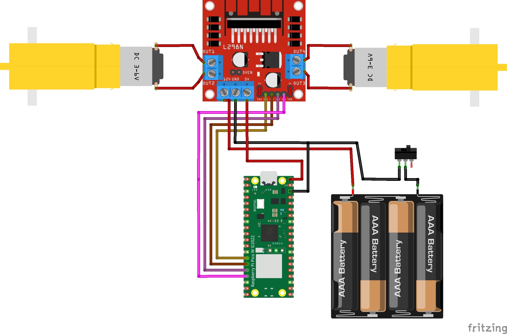

# Electronics Guide

This page describes the main electrical components supplied during the Makeathon, what they do, how they work, and how they fit into the robot.

## Contents

- [Raspberry Pi Pico](#raspberry-pi-pico)
- [DC Motors](#dc-motors)
- [L298N Motor Controller](#l298n-motor-controller)
- [IR Infrared Sensor Modules](#ir-infrared-sensor-modules)
- [Ultrasonic Distance Sensors](#ultrasonic-distance-sensors)
- [Breadboard](#breadboard)
- [4x AA Battery Pack](#4x-aa-battery-pack)
- [How the Components Work Together](#how-the-components-work-together)

## Raspberry Pi Pico

A **microcontroller** is a small computer designed to read electrical signals and control hardware. The Raspberry Pi Pico is the robot's controller: it reads the sensors, makes simple decisions, and sends control signals to the motor driver.


*Reference pinout for the Raspberry Pi Pico. It shows physical header positions, GPIO labels, power and ground pins, ADC-capable pins, and alternate functions including UART, SPI, and I2C.*

The **physical pin number** and **GPIO number** are not the same thing. Physical numbers describe positions along the board's two edges. MicroPython normally refers to the green `GP` labels: for example, a pin labelled `GP15` is GPIO 15 in MicroPython, even though its physical header position is pin 20 in this reference diagram. Do not use this example as a Makeathon pin assignment; follow the final wiring guide when assignments are confirmed.

> The Pico pinout shows advanced interfaces such as UART, SPI, and I2C. You do not need to understand all of these for the Makeathon. The robot mainly uses GPIO for sensor and motor-driver signals, plus the appropriate power and ground connections.

### Pico Pins Used in the Makeathon

The final GPIO assignments are still to be confirmed. For now, focus on what each relevant **type** of pin does.

#### GPIO pins

**GPIO** means general-purpose input/output. A GPIO can be configured as a digital input to receive a sensor's `OUT` signal, or as a digital output to send HIGH/LOW control signals to L298N inputs such as IN1 and IN2. Pico GPIO uses **3.3 V logic**, so an input must not receive a voltage above its safe range.

MicroPython refers to the GPIO number, for example `Pin(2)`, rather than the physical header position. The number `2` here is an example only, not a final Makeathon assignment.

#### GND pins

**GND** is the electrical reference and current return path for the control circuit. The sensor, Pico, and L298N control side need a shared ground so that they agree on what HIGH and LOW mean. The Pico has multiple GND pins; they are electrically common, so the final wiring design can select a convenient one.

#### `3V3(OUT)`

`3V3(OUT)` is the Pico's regulated 3.3 V output. It can power suitable low-power 3.3 V devices, but it must never power a motor. Whether it should power the supplied IR sensors depends on their confirmed voltage and current requirements.

#### `VSYS`

`VSYS` is a Pico system-power input. It can power the Pico when supplied within the board's supported input range. Do not connect the Makeathon battery to it unless the final power design explicitly instructs you to do so.

> The final standalone power connection for the Raspberry Pi Pico is still to be confirmed. Follow the final Makeathon wiring diagram once published.

#### `VBUS`

`VBUS` is the USB-derived 5 V rail present when the Pico is powered through USB. It is a power connection, not a GPIO, and it is not the Pico's 3.3 V logic level. Its use, if any, must follow the confirmed power design.

#### ADC-capable pins

An **ADC** (analogue-to-digital converter) measures a varying voltage. The currently shown IR module supplies a digital `OUT` signal, so normal use does not require an ADC. ADC would become relevant only if the final sensor had a confirmed analogue output.

#### PWM-capable GPIO

PWM is a function generated by GPIO; it is not a separate physical “PWM pin”. A suitable GPIO can produce a rapidly switched PWM control signal for L298N ENA or ENB when variable motor speed is wanted. The final choice of GPIO remains TBD.

GPIO pins can supply only small signal currents. Motors draw far more current, particularly when starting or stalled, and also produce electrical noise. Never power a motor from a GPIO pin; use the L298N motor controller and the motor supply path.

> **Note:** GPIO numbers in the examples below are for demonstration only. Refer to the [Makeathon wiring guide](../wiring/full_system_wiring.md) for the final pin assignments.

### Generic digital output

This example creates a digital output on example GPIO 2, then sets it HIGH (`1`) and LOW (`0`):

```python
from machine import Pin

# Example GPIO number only — not a final Makeathon pin assignment.
output = Pin(2, Pin.OUT)

output.value(1)  # HIGH
output.value(0)  # LOW
```

`from machine import Pin` imports MicroPython's GPIO interface. In `Pin(2, Pin.OUT)`, `2` means example GPIO 2 and `Pin.OUT` makes it an output. It could send a HIGH/LOW control signal to an L298N input such as IN1; it does **not** supply motor power.

### Generic digital input

This example configures example GPIO 15 as an input, reads its current state, and prints the resulting `0` or `1`:

```python
from machine import Pin

# Example GPIO number only — not a final Makeathon pin assignment.
input_pin = Pin(15, Pin.IN)

state = input_pin.value()
print(state)
```

In `Pin(15, Pin.IN)`, `15` means example GPIO 15 and `Pin.IN` makes it receive a digital signal rather than produce one. That input could receive the signal from an IR sensor's `OUT` pin.

Read more about [GPIO](../concepts/gpio.md), [PWM](../concepts/pwm.md), and [Pico setup](../guides/pico_setup.md).

## DC Motors

A DC motor converts electrical energy into rotation. Current flowing through coils creates magnetic forces that turn its shaft. The supplied wheels attach to the motor shafts so that this rotation moves the robot.

Swapping the two motor wires reverses the current and normally reverses the direction of rotation. Speed depends on the motor's load and its effective applied voltage. PWM can vary the average energy delivered, so a higher duty cycle usually produces a higher speed; it does not guarantee an exact speed.

Motors draw significant current. **Startup current** is the brief high current needed to begin turning, while **stall current** is the high current drawn when the shaft cannot turn. Motor switching and brushes can also introduce electrical noise, which may disturb sensors or reset a poorly powered controller. These are reasons to use a motor driver instead of Pico GPIO.

The motor itself is not controlled directly by Pico code. The software changes control signals connected to the L298N, and the driver switches motor current from the motor supply:



Connecting a DC motor directly to a Pico GPIO can damage the Pico. All motor examples in this guide therefore operate through the motor driver.

> Exact motor model, operating voltage, current, and speed specifications are to be confirmed.

See [motors to L298N](../wiring/motors_to_l298n.md) and [motor direction](../concepts/motor_direction.md).

## L298N Motor Controller

The L298N module is a motor driver: it accepts low-current control signals and switches the larger current required by the motors. Internally, an **H-bridge** can drive current through a motor in either direction.

It provides two motor channels. Common labels are:

- **IN1/IN2** for the direction of Motor A.
- **IN3/IN4** for the direction of Motor B.
- **ENA/ENB** for enabling each channel; on many modules these inputs can accept PWM for speed control.


*Reference pinout for a common L298N module. The supplied module must still be checked because layouts, labels, and jumper arrangements can vary. The visible source credit in the diagram has been preserved.*

### L298N Pins Used in the Makeathon

| Pin or terminal | Type | Function |
|---|---|---|
| ENA | Control signal | Enables Motor A; a fitted enable jumper commonly holds it HIGH, or it can accept PWM for speed control when configured appropriately |
| IN1 | Control signal | One of Motor A's two direction/braking inputs |
| IN2 | Control signal | The other Motor A direction/braking input |
| IN3 | Control signal | One of Motor B's two direction/braking inputs |
| IN4 | Control signal | The other Motor B direction/braking input |
| ENB | Control signal | Enables Motor B; a fitted enable jumper commonly holds it HIGH, or it can accept PWM for speed control when configured appropriately |
| OUT1 | Motor output | One motor-current connection for Motor A |
| OUT2 | Motor output | The other motor-current connection for Motor A |
| OUT3 | Motor output | One motor-current connection for Motor B |
| OUT4 | Motor output | The other motor-current connection for Motor B |
| Motor supply / `+12V` terminal | Power input | Supplies the motor stage; the label does not mean the supplied system must use exactly 12 V |
| GND | Power return/reference | Motor-supply return and common reference for Pico control signals |
| 5V terminal | Configuration-dependent power/logic terminal | Its use depends on the module's regulator and jumper arrangement |

When ENA or ENB is HIGH/enabled, its channel can respond to the corresponding IN inputs. PWM on ENA or ENB can repeatedly enable and disable the channel to adjust the drive command. Holding the enable input LOW disables the channel and normally lets the motor coast.

### ENA and ENB jumpers

On many common L298N modules, a small removable jumper links each enable input to the module's logic HIGH supply:

- With the **ENA jumper fitted**, Motor A is continuously enabled. This is equivalent to a 100% enable command, so IN1 and IN2 control its direction or braking.
- With the **ENB jumper fitted**, Motor B is continuously enabled. This is equivalent to a 100% enable command, so IN3 and IN4 control its direction or braking.
- To control speed with Pico PWM, the relevant enable jumper is normally removed and that EN pin is connected to a confirmed Pico PWM GPIO.

“100% enable” means that the driver channel is enabled for the whole PWM cycle. It does **not** guarantee that the motor reaches 100% of its advertised speed; battery voltage, L298N voltage loss, load, friction, and the motor itself still matter.

Do not manually short ENA and ENB together or bridge them to an arbitrary power pin. Use only the module's intended enable jumper positions, after confirming that the supplied board matches the reference layout. Switch power off before fitting or removing a jumper.

IN1/IN2 and IN3/IN4 are low-current control signals from the Pico. Their HIGH/LOW combinations select direction or braking. OUT1–OUT4 are different: they carry motor drive current to the motors and must **not** connect to Pico GPIO.

The Pico and L298N must share the required common ground so the driver interprets control voltages correctly. Never connect battery positive to a GPIO pin, and verify all power terminals before switching on.

Do not copy power connections from the reference picture alone. In particular, do not assume how the 5 V terminal or onboard regulator should be used until the exact supplied board configuration is confirmed.


The motor supply carries motor power, while the input pins carry logic/control signals. They serve different purposes. The Pico and motor controller must normally share a ground so their control signals have the same reference.

### Motor A control table

IN1 and IN2 select the direction for Motor A. ENA enables the channel and can also receive PWM for speed control. The following table describes the standard control concept when the module is correctly powered and configured:

| IN1 | IN2 | ENA | Motor A behaviour |
|---:|---:|---:|---|
| 1 | 0 | 1 | Direction A |
| 0 | 1 | 1 | Direction B |
| 0 | 0 | 1 | Brake / stop |
| 1 | 1 | 1 | Brake / stop |
| X | X | 0 | Disabled / coast |

- `1` means logic HIGH.
- `0` means logic LOW.
- `X` means that the input does not matter in that state.
- Direction A and Direction B are opposite rotations. Which one moves the robot physically forward depends on motor mounting and the order of the two motor wires.
- Swapping a motor's two output wires swaps its Direction A and Direction B. Do this only with power off; never reverse the battery leads.

When the common ENA jumper is fitted, ENA is normally held at `1`, so the first four rows apply. Removing that jumper allows a Pico PWM signal to vary how much of each cycle ENA spends at `1`. Confirm this behavior on the exact supplied module before wiring it.

Motor B works in the same way: IN3 and IN4 select its direction, while ENB enables the channel or accepts its PWM signal.

**Braking** and **coasting** are different. With braking, both H-bridge outputs actively drive the motor terminals to the same state, opposing continued rotation. With coasting, the channel is disabled and its outputs do not actively drive the motor, so it slows more naturally. The exact stopping feel depends on the motor, load, and module.

### Controlling one channel with MicroPython

This isolated example controls only the direction inputs for one L298N channel. It assumes ENA has already been enabled safely using the confirmed module arrangement.

```python
from machine import Pin

# Example GPIO numbers only — these are not final Makeathon pin assignments.
in1 = Pin(2, Pin.OUT)
in2 = Pin(3, Pin.OUT)
```

The two `Pin` objects create digital outputs on example GPIO 2 and GPIO 3. Each output can then be set HIGH or LOW. This pair requests Direction A:

Here, example GPIO 2 would carry a control signal to L298N IN1 and example GPIO 3 would carry one to IN2. These GPIO outputs control the driver; they do not carry motor current.

```python
# Direction A
in1.value(1)
in2.value(0)
```

Changing the two states requests the opposite rotation, Direction B:

```python
# Direction B
in1.value(0)
in2.value(1)
```

Setting both direction inputs LOW requests the brake/stop state shown in the table:

```python
# Stop / brake
in1.value(0)
in2.value(0)
```

Test with the wheels raised and identify which direction is physically forward on the assembled robot. These snippets deliberately do not define a driving function or connect motor behaviour to sensor readings.

### Motor speed with PWM

If the confirmed L298N module configuration allows PWM on ENA, this example creates a 1,000 Hz PWM signal on example GPIO 4 and requests approximately 50% duty cycle:

```python
from machine import Pin, PWM

# Example GPIO number only — not a final Makeathon pin assignment.
enable_a = PWM(Pin(4))
enable_a.freq(1000)

# Approximately 50% duty cycle
enable_a.duty_u16(32768)
```

`PWM(Pin(4))` assigns PWM to the example enable pin, `freq(1000)` sets 1,000 switching cycles per second, and `duty_u16()` sets the on-time using a value from 0 to 65,535.

| ENA PWM duty | `duty_u16()` value | Approximate command |
|---:|---:|---|
| 0% | 0 | Disabled |
| 25% | about 16,384 | Low drive |
| 50% | about 32,768 | Medium drive |
| 75% | about 49,151 | Higher drive |
| 100% | 65,535 | Full drive |

PWM rapidly switches the enable signal on and off. These are command levels, not guaranteed percentages of actual motor speed. Friction, motor characteristics, battery voltage, load, and the L298N voltage drop all affect the result. There is no universal ideal duty cycle.

### Varying the speed command

The next isolated example creates separate PWM outputs for ENA and ENB. The helper converts a percentage into the 16-bit value expected by `duty_u16()`:

```python
from machine import Pin, PWM

# Example GPIO numbers only — not final Makeathon pin assignments.
# Remove the corresponding enable jumpers before connecting Pico PWM.
enable_a = PWM(Pin(4))
enable_b = PWM(Pin(5))

enable_a.freq(1000)
enable_b.freq(1000)

def set_speed_percent(enable_pwm, percent):
    percent = max(0, min(100, percent))
    duty = int(percent * 65535 / 100)
    enable_pwm.duty_u16(duty)

# Manual example commands for the two independent motor channels.
set_speed_percent(enable_a, 25)
set_speed_percent(enable_b, 60)
```

`enable_a` would connect to ENA and `enable_b` to ENB. Calling `set_speed_percent(enable_a, 25)` requests a 25% duty cycle for Motor A's channel; changing `25` to another value from 0 to 100 changes the command. The same applies independently to Motor B.

The direction inputs must already be set to a valid direction state before a motor will turn. To stop sending PWM and disable a channel, request 0%:

```python
set_speed_percent(enable_a, 0)
set_speed_percent(enable_b, 0)
```

This example only demonstrates manual speed commands. It does not decide speeds from sensor readings or implement a line-following algorithm.

The L298N is an older design and loses some voltage as heat, so the motors receive less voltage than the battery provides. Its exact terminals, jumpers, regulator arrangement, and logic-power requirements vary between modules.

> Exact supplied module layout and jumper configuration are to be confirmed.

Wiring polarity matters: reversing a supply connection can damage hardware, while reversing one motor's output wires changes that motor's direction. See [Pico to L298N wiring](../wiring/pico_to_l298n.md).

## IR Infrared Sensor Modules

An IR reflectance sensor shines infrared light at the floor with an **emitter** and measures reflected light with a **receiver**. A dark line typically absorbs more infrared light and reflects less back to the receiver, while a lighter background typically reflects more. The module detects this difference, allowing sensors underneath the robot to help determine whether they are over the line or the background.

This is the usual operating principle, not a guaranteed mapping. Surface material, gloss, colour, sensor height, and ambient light can affect reflection. The supplied sensors must therefore be tested and calibrated rather than assuming which digital value represents the line.


*Reference view of a common IR sensor module, showing the transmitter, receiver, adjustment control, indicator LEDs, and VCC/GND/OUT pins. Confirm that the supplied module matches before wiring it.*

The labelled parts work together as follows:

1. The **IR transmitter** emits infrared light towards a nearby surface.
2. The surface reflects some light towards the **IR receiver**.
3. The receiver measures the reflected light.
4. An onboard comparator compares that signal with a threshold set by the **sensitivity potentiometer**.
5. The module changes its digital **OUT** state when the threshold is crossed.

**VCC** and **GND** power the module, while **OUT** carries the digital result to a Pico input. The power LED indicates that the module is powered. The object-detect/output LED indicates the comparator's current detection state; its exact behaviour must be checked on the supplied module. Turning the potentiometer changes the switching threshold, not the amount of infrared light emitted.

Many modules compare the received signal with a threshold and provide a digital HIGH or LOW output. Some include a small potentiometer for adjusting that threshold. The output sense, supply requirements, pin order, and whether a potentiometer is fitted depend on the exact module.

> Exact sensor model, pinout, supply range, output voltage, and output sense are to be confirmed.

### IR Sensor Pins

| Pin | Function | What it does |
|---|---|---|
| VCC | Power input | Supplies electrical power to the sensor module |
| GND | Ground | Provides the electrical reference and current return path |
| OUT | Digital output | Sends the comparator's detected state to a Pico GPIO input |

#### VCC

VCC powers the sensor's emitter, receiver, comparator, and indicator circuit. It is a **power input**, not a sensor reading. Connect it only to an appropriate supply whose voltage is safe for the exact module; the supported range still needs to be confirmed.

#### GND

GND is both the module's current return path and its electrical reference. The sensor and Pico must share a common ground so that the Pico can interpret the voltage on `OUT` correctly.

#### OUT

OUT is a **signal output** from the module's comparator. It changes between LOW and HIGH when the reflected-light signal crosses the threshold set by the potentiometer. Connect OUT to a Pico GPIO configured as an input—not to a Pico power pin. The meaning of HIGH and LOW for the line and background must be measured on the supplied sensor because modules can invert their outputs.

The conceptual connections for either sensor are:

| IR sensor pin | Connects to | Purpose |
|---|---|---|
| VCC | Appropriate confirmed supply | Powers the sensor |
| GND | Pico/system GND | Establishes a common reference and return path |
| OUT | `Pico GPIO <TBD>` | Carries the digital sensor state |

The [single-sensor digital-input example](#reading-one-digital-sensor) below shows how MicroPython reads `OUT`. Do not confuse `OUT` with VCC, and check all three labels before applying power.

Mounting height and position strongly affect readings. Both sensors should face the surface consistently without touching it. Ambient light, floor material, line colour, dust, and shadows can also change the result. Test and calibrate the sensors on the actual course surface rather than assuming that one setting will always work.

### Reading one digital sensor

This minimal example reads one sensor output connected to example GPIO 15:

```python
from machine import Pin

# Example GPIO number only — not a final Makeathon pin assignment.
sensor = Pin(15, Pin.IN)

value = sensor.value()
print(value)
```

In `Pin(15, Pin.IN)`, `15` means GPIO 15 in this example only. `Pin.IN` configures it as an input that would receive the sensor's `OUT` signal. `sensor.value()` reads the current digital state, normally `0` or `1`, and `print()` displays it in the Thonny Shell.

Do not assume that `0` means the line or that `1` means the background. Different modules can invert this relationship. Move the actual sensor over both the line and the background, observe the values, and write down the result.

For continuous testing, this example prints one reading every 0.1 seconds:

```python
from machine import Pin
from time import sleep

# Example GPIO number only — not a final Makeathon pin assignment.
sensor = Pin(15, Pin.IN)

while True:
    print(sensor.value())
    sleep(0.1)
```

`while True` repeats until the program is stopped, while `sleep(0.1)` places a short pause between readings so that the output is easier to follow. Use Thonny's Stop/Interrupt control when finished.

### Testing two sensor inputs

It is also useful to inspect both sensors at once without making any movement decision:

```python
from machine import Pin
from time import sleep

# Example GPIO numbers only — not final Makeathon pin assignments.
left_sensor = Pin(14, Pin.IN)
right_sensor = Pin(15, Pin.IN)

while True:
    left = left_sensor.value()
    right = right_sensor.value()

    print("Left:", left, "Right:", right)
    sleep(0.1)
```

Move the sensors manually across the line and background, then record the combinations you observe. This example only measures and displays inputs. Deciding how the motors should respond to those combinations is part of the Makeathon challenge.

Before relying on the readings, follow the [IR sensor calibration guide](../guides/ir_sensor_calibration.md).

See [Pico to IR sensor wiring](../wiring/pico_to_ir_sensors.md) and [digital inputs](../concepts/digital_inputs.md).

## Ultrasonic Distance Sensors

An ultrasonic distance sensor estimates the distance to an object using sound pulses above the normal range of human hearing. The supplied reference image identifies an HC-SR04-style module.


*Reference pinout for an HC-SR04 ultrasonic distance sensor. The visible source watermark has been preserved. Confirm that the supplied modules match before wiring them.*

### How it works

The two round components are ultrasonic transducers. One transmits a brief burst of sound and the other listens for the reflection:

1. The Pico sends a short HIGH pulse to **Trig**.
2. The module transmits an ultrasonic burst.
3. Sound reflects from a nearby object.
4. The module holds **Echo** HIGH for a time related to the sound's round trip.
5. The Pico measures that pulse duration and calculates an estimated distance.

Because the sound travels to the object and back, the calculation divides the total travel distance by two. See [Ultrasonic Distance Measurement](../concepts/ultrasonic_distance.md) for the time-of-flight concept and common measurement limitations.

### Ultrasonic sensor pins

| Pin | Type | What it does |
|---|---|---|
| VCC | Power input | Powers the sensor module; use only the confirmed supply |
| Trig | Digital input to sensor | Receives a short control pulse from a Pico GPIO output |
| Echo | Digital output from sensor | Produces a timed pulse for a Pico GPIO input, through confirmed level conditioning |
| GND | Ground | Provides the electrical reference and current return path |

#### VCC and GND

The reference HC-SR04 design commonly uses a 5 V supply, but the exact supplied module and final power rail must be confirmed. GND must be shared with the Pico so that Trig and Echo have a common voltage reference.

#### Trig

Trig starts one measurement. The Pico configures its connected GPIO as an output, briefly drives it HIGH, and then returns it LOW. Trig is a signal input; it does not power the module.

#### Echo

Echo is the measurement signal returned by the module. Its HIGH-pulse duration represents the ultrasonic round-trip time.

> **Voltage warning:** Standard HC-SR04 modules can produce a 5 V Echo signal. Pico GPIO uses 3.3 V logic. Do not connect Echo directly to the Pico unless its voltage has been confirmed safe; use the approved voltage divider or level shifter from the final Makeathon wiring design.

### Minimal MicroPython distance test

The following example demonstrates one sensor only. GPIO 6 and GPIO 7 are examples, not final Makeathon assignments. It assumes Echo already passes through the confirmed level-conditioning circuit.

```python
from machine import Pin, time_pulse_us
from time import sleep, sleep_us

# Example GPIO numbers only — not final Makeathon pin assignments.
trigger = Pin(6, Pin.OUT)
echo = Pin(7, Pin.IN)
trigger.value(0)

def read_distance_cm():
    # Send the short trigger pulse.
    trigger.value(0)
    sleep_us(2)
    trigger.value(1)
    sleep_us(10)
    trigger.value(0)

    # Measure how long Echo remains HIGH, with a timeout.
    pulse_us = time_pulse_us(echo, 1, 30000)
    if pulse_us < 0:
        return None

    # Sound travels to the object and back, so divide by two.
    return pulse_us * 0.0343 / 2

while True:
    distance = read_distance_cm()
    if distance is None:
        print("No echo received")
    else:
        print("Distance:", distance, "cm")
    sleep(0.2)
```

`Pin.OUT` configures the example Trig GPIO to send the trigger pulse. `Pin.IN` configures the example Echo GPIO to receive the conditioned pulse. `time_pulse_us(echo, 1, 30000)` measures a HIGH pulse in microseconds and stops waiting after the timeout. A negative result means a complete pulse was not measured.

The factor `0.0343` is the approximate speed of sound in centimetres per microsecond at room temperature. Actual readings vary with temperature, surface angle, object material, mounting, and the sensor itself.

For the second sensor, use a separate confirmed Trig/Echo GPIO pair. Trigger the two modules one at a time with a pause between them; simultaneous measurements can interfere with each other. This example deliberately reports distance only and does not contain obstacle-avoidance or motor-control logic.

See [Pico to ultrasonic sensor wiring](../wiring/pico_to_ultrasonic_sensors.md) and [ultrasonic troubleshooting](../troubleshooting/README.md).

## Breadboard

A breadboard makes temporary circuits without solder. Holes in each short terminal strip are connected internally. The centre gap separates the two sides so that dual-inline components can straddle it. Long side rails are often used for power and ground.

The breadboard is a passive electrical connection tool and is not controlled by software.


This diagram is conceptual: check the markings and continuity of the actual board. On some breadboards, a power rail is split in the middle and the two halves are not connected unless bridged.

Common mistakes include placing two wires in holes that are not connected, putting signal and power wires in the same connected row, assuming split rails are continuous, or reversing the positive and ground rails. Disconnect power before moving wires and inspect for accidental shorts.

## 4x AA Battery Pack

The holder connects four cells in **series**, so their voltages add. The nominal voltage of each cell depends on its chemistry, and the real voltage changes with charge and load. Four cells therefore do not always provide exactly the same operating voltage.

> Supplied battery chemistry and its confirmed voltage range are to be confirmed.

Observe the `+` and `-` markings. The pack must feed the intended motor/power path, not a Pico GPIO pin. The motor controller and Pico control circuit need a common ground where required by the final design.

Batteries must be able to deliver the motors' startup current. Their voltage can temporarily drop under load; this is called **battery sag** and can cause weak motors or controller resets.

Never short the pack terminals. Remove or switch off the batteries before rewiring, do not mix cell types or old and new cells, and replace damaged or leaking cells safely. See the [battery wiring guide](../wiring/battery_pack.md).

The battery pack does not require MicroPython code. It provides electrical power, and software cannot correct reversed polarity, a short circuit, or unsafe wiring.

## How the Components Work Together

The IR sensors report the surface beneath the robot, while the ultrasonic sensors can provide distance measurements. The Pico reads those signals and chooses motor commands. The L298N converts the Pico's control signals into the higher-current drive needed by the motors. The battery supplies the motor/power system.

```text
[Left IR sensor]  --\
                    >-- [Raspberry Pi Pico] --control/PWM--> [L298N] --> [Left motor]
[Right IR sensor] --/                                      └----------> [Right motor]

[Ultrasonic sensors] <-- Trig / conditioned Echo ----------> [Pico]

[Battery pack] --------------------------motor power-------> [L298N]
        Ground reference shared where required by the confirmed design
```

Continue with the [full-system wiring guide](../wiring/full_system_wiring.md), complete the [pre-power check](../guides/pre_power_check.md), and use [troubleshooting](../troubleshooting/README.md) if something does not behave as expected.
