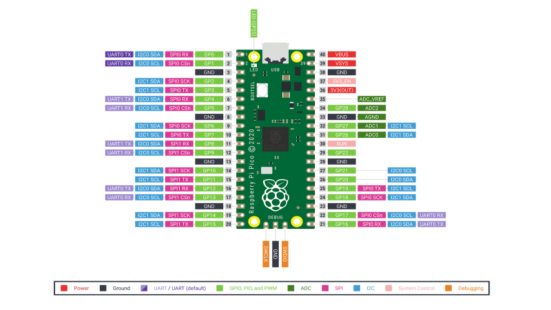
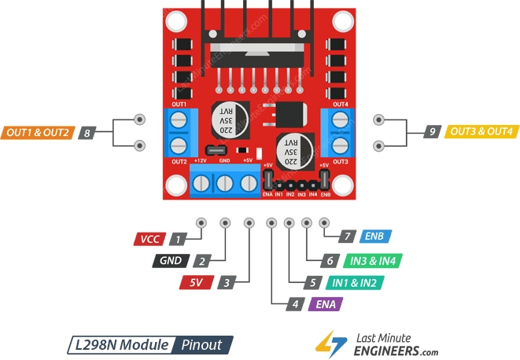
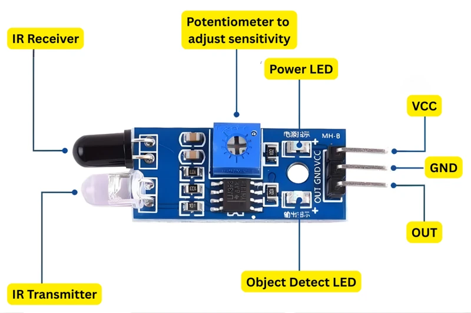
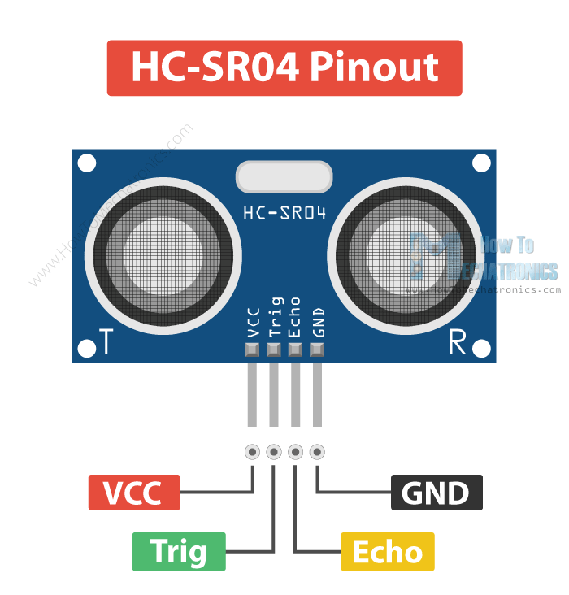
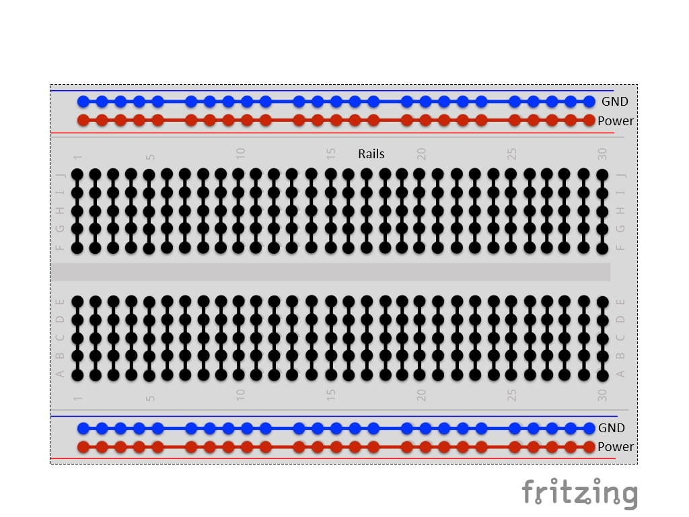

# Electronics Guide

This page describes the main electrical components supplied during the Makeathon, what they do, how they work, and how they fit into the robot.

## Contents

- [Raspberry Pi Pico](#raspberry-pi-pico)
- [DC Motors](#dc-motors)
- [L298N Motor Controller](#l298n-motor-controller)
- [IR Infrared Sensor Modules](#ir-infrared-sensor-modules)
- [Ultrasonic Distance Sensors](#ultrasonic-distance-sensors)
- [Voltage and Power Reference](#voltage-and-power-reference)
- [Breadboard](#breadboard)
- [4x AA Battery Pack](#4x-aa-battery-pack)
- [How the Components Work Together](#how-the-components-work-together)

## Raspberry Pi Pico

A **microcontroller** is a small computer designed to read electrical signals and control hardware. The Raspberry Pi Pico is the robot's controller: it reads the sensors, makes simple decisions, and sends control signals to the motor driver.



*Reference pinout for the Raspberry Pi Pico. It shows physical header positions, GPIO labels, power and ground pins, ADC-capable pins, and alternate functions including UART, SPI, and I2C.*

The **physical pin number** and **GPIO number** are not the same thing. Physical numbers describe positions along the board's two edges. MicroPython refers to the green `GP` labels: for example, `Pin(15)` means GP15, which is physical header pin 20. Follow the [final wiring table](../wiring/full_system_wiring.md) for every assignment.

> The Pico pinout shows advanced interfaces such as UART, SPI, and I2C. You do not need to understand all of these for the Makeathon. The robot mainly uses GPIO for sensor and motor-driver signals, plus the appropriate power and ground connections.

### Pico Pins Used in the Makeathon

The final GPIO assignments are listed in the [authoritative full-system wiring table](../wiring/full_system_wiring.md). This section explains what each relevant **type** of pin does.

| Pico pin | Purpose |
|---|---|
| `VSYS` | Main external system-power input; approximately 1.8–5.5 V |
| `VBUS` | Approximately USB 5 V while USB is connected |
| `3V3(OUT)` | Regulated 3.3 V output generated by the Pico |
| `GND` | Electrical ground and signal reference |

#### GPIO pins

**GPIO** means general-purpose input/output. A GPIO can be configured as a digital input to receive a sensor's `OUT` signal, or as a digital output to send HIGH/LOW control signals to L298N inputs such as IN1 and IN2. Pico GPIO uses **3.3 V logic**: a HIGH produced by the Pico is approximately 3.3 V, and a GPIO input must never receive 5 V directly. A device output may connect directly only when it is specifically known to be safe for 3.3 V GPIO.

> **Important:** The Pico may be powered through VSYS with a voltage above 3.3 V, but its GPIO signals are still 3.3 V logic.

MicroPython refers to the GPIO number rather than the physical header position. For example, `Pin(2)` selects final motor-control signal GP2, not physical pin 2.

#### GND pins

**GND** is the electrical reference and current return path for the control circuit. The sensor, Pico, and L298N control side need a shared ground so that they agree on what HIGH and LOW mean. The Pico has multiple GND pins; they are electrically common, so the final wiring design can select a convenient one.

#### `3V3(OUT)`

`3V3(OUT)` is the Pico's regulated 3.3 V output. It powers both IR sensor VCC pins, but it must never power a motor. It is not a battery input, and the battery must not be connected here.

#### `VSYS`

`VSYS` is the Pico's main external system-power input. The standard Raspberry Pi Pico accepts approximately **1.8 V to 5.5 V on VSYS**; its onboard regulator then generates the internal 3.3 V rail. The current four-AA-cell pack is approximately 6 V nominal and fresh cells may be higher, so **do not connect that pack directly to VSYS**.

For untethered operation, the L298N `5V` terminal supplies Pico `VSYS`. The nominal 6 V battery pack must not connect directly to `VSYS`.

#### `VBUS`

`VBUS` is approximately the USB 5 V rail while USB is connected. It is a power connection, not a GPIO, and it is unavailable as an independent source when USB is disconnected. The competition robot runs untethered from the L298N 5 V rail through `VSYS`; USB is for programming, Thonny, debugging, and development.

### Supply voltage and signal voltage

**Supply voltage** powers a component: examples include Pico `VSYS`, sensor `VCC`, and the L298N motor supply. **Logic or signal voltage** carries information: examples include Pico GPIO HIGH/LOW, IR `OUT`, ultrasonic `Trig`/`Echo`, and L298N IN1–IN4. They are not necessarily the same. A sensor can use 5 V power while one of its signals still needs conversion before it is safe for a 3.3 V Pico input.

#### ADC-capable pins

An **ADC** (analogue-to-digital converter) measures a varying voltage. The currently shown IR module supplies a digital `OUT` signal, so normal use does not require an ADC. ADC would become relevant only if the final sensor had a confirmed analogue output.

#### PWM-capable GPIO

PWM is a function generated by GPIO; it is not a separate physical “PWM pin”. GP4 supplies PWM to L298N ENA for the left motor, and GP8 supplies PWM to ENB for the right motor.

GPIO pins can supply only small signal currents. Motors draw far more current, particularly when starting or stalled, and also produce electrical noise. Never power a motor from a GPIO pin; use the L298N motor controller and the motor supply path.

> **Note:** The hardware examples below use the final Makeathon GPIO assignments. MicroPython uses GPIO numbers, not physical header-pin numbers.

### Generic digital output

This example uses final left-motor direction pin GP2, then sets it HIGH (`1`) and LOW (`0`):

```python
from machine import Pin

left_in1 = Pin(2, Pin.OUT)

left_in1.value(1)  # HIGH
left_in1.value(0)  # LOW
```

`from machine import Pin` imports MicroPython's GPIO interface. In `Pin(2, Pin.OUT)`, `2` means GP2 and `Pin.OUT` makes it an output. GP2 sends a HIGH/LOW control signal to L298N IN1; it does **not** supply motor power.

### Generic digital input

This example configures final right IR input GP15, reads its current state, and prints the resulting `0` or `1`:

```python
from machine import Pin

right_ir = Pin(15, Pin.IN)

state = right_ir.value()
print(state)
```

In `Pin(15, Pin.IN)`, `15` means GP15 and `Pin.IN` makes it receive the right IR sensor's `OUT` signal rather than produce one.

Read more about [GPIO](../concepts/gpio.md), [PWM](../concepts/pwm.md), and [Pico setup](../guides/pico_setup.md).

## DC Motors

A DC motor converts electrical energy into rotation. Current flowing through coils creates magnetic forces that turn its shaft. The supplied wheels attach to the motor shafts so that this rotation moves the robot.

Swapping the two motor wires reverses the current and normally reverses the direction of rotation. Speed depends on the motor's load and its effective applied voltage. PWM can vary the average energy delivered, so a higher duty cycle usually produces a higher speed; it does not guarantee an exact speed.

Motors draw significant current. **Startup current** is the brief high current needed to begin turning, while **stall current** is the high current drawn when the shaft cannot turn. Motor switching and brushes can also introduce electrical noise, which may disturb sensors or reset a poorly powered controller. These are reasons to use a motor driver instead of Pico GPIO.

The motor itself is not controlled directly by Pico code. The software changes control signals connected to the L298N, and the driver switches motor current from the motor supply. See the [final Makeathon wiring diagram and authoritative connection tables](../wiring/full_system_wiring.md) for the complete circuit. Older reference images may show a different Pico model, battery pack, or pin assignment and must not be copied as event wiring.

Connecting a DC motor directly to a Pico GPIO can damage the Pico. All motor examples in this guide therefore operate through the motor driver.

> Exact motor model, operating voltage, current, and speed specifications are to be confirmed.

See [motors to L298N](../wiring/motors_to_l298n.md) and [motor direction](../concepts/motor_direction.md).

## L298N Motor Controller

The L298N module is a motor driver: it accepts low-current control signals and switches the larger current required by the motors. Internally, an **H-bridge** can drive current through a motor in either direction.

It provides two motor channels. Common labels are:

- **IN1/IN2** for the direction of Motor A.
- **IN3/IN4** for the direction of Motor B.
- **ENA/ENB** for enabling each channel; on many modules these inputs can accept PWM for speed control.



*Reference pinout for a common L298N module. The supplied module must still be checked because layouts, labels, and jumper arrangements can vary. The visible source credit in the diagram has been preserved.*

### L298N Pins Used in the Makeathon

| Pin or terminal | Type | Function |
|---|---|---|
| ENA | Control signal | Enables Motor A; a fitted enable jumper commonly holds it HIGH, or it can accept PWM for speed control when configured appropriately |
| IN1 | Control signal | One of Motor A's two direction/braking inputs |
| IN2 | Control signal | The other Motor A direction/braking input |
| IN3 | Control signal | One of Motor B's two direction/braking inputs |
| IN4 | Control signal | The other Motor B direction/braking input |
| ENB | Control signal | Enables Motor B; a fitted enable jumper commonly holds it HIGH, or it can accept PWM for speed control when configured appropriately |
| OUT1 | Motor output | One motor-current connection for Motor A |
| OUT2 | Motor output | The other motor-current connection for Motor A |
| OUT3 | Motor output | One motor-current connection for Motor B |
| OUT4 | Motor output | The other motor-current connection for Motor B |
| Motor supply / `+12V` terminal | Power input | Supplies the motor stage; the label does not mean the supplied system must use exactly 12 V |
| GND | Power return/reference | Motor-supply return and common reference for Pico control signals |
| 5V terminal | Power rail | Supplies Pico `VSYS` and both HC-SR04 VCC pins in the final architecture |

When ENA or ENB is HIGH/enabled, its channel can respond to the corresponding IN inputs. PWM on ENA or ENB can repeatedly enable and disable the channel to adjust the drive command. Holding the enable input LOW disables the channel and normally lets the motor coast.

### ENA, ENB, and regulator jumpers

On many common L298N modules, a small removable jumper links each enable input to the module's logic HIGH supply:

- With the **ENA jumper fitted**, Motor A is continuously enabled. This is equivalent to a 100% enable command, so IN1 and IN2 control its direction or braking.
- With the **ENB jumper fitted**, Motor B is continuously enabled. This is equivalent to a 100% enable command, so IN3 and IN4 control its direction or braking.
- For Pico PWM speed control, remove the ENA and ENB jumpers if they permanently tie the inputs HIGH. GP4 connects to ENA and GP8 connects to ENB.

“100% enable” means that the driver channel is enabled for the whole PWM cycle. It does **not** guarantee that the motor reaches 100% of its advertised speed; battery voltage, L298N voltage loss, load, friction, and the motor itself still matter.

Do not manually short ENA and ENB together or bridge them to an arbitrary power pin. Use only the module's intended enable jumper positions, after confirming that the supplied board matches the reference layout. Switch power off before fitting or removing a jumper.

The **ENA jumper** enables Motor A and the **ENB jumper** enables Motor B. A separate jumper often labelled **5V-EN** or **regulator enable** controls the onboard 5 V regulator on common modules. It is a different circuit and must not be confused with either motor-enable jumper. Removing ENA/ENB for Pico PWM does not decide how the regulator jumper should be configured.

IN1/IN2 and IN3/IN4 are low-current control signals from the Pico. Their HIGH/LOW combinations select direction or braking. OUT1–OUT4 are different: they carry motor drive current to the motors and must **not** connect to Pico GPIO.

The Pico and L298N must share the required common ground so the driver interprets control voltages correctly. Never connect battery positive to a GPIO pin, and verify all power terminals before switching on.

The final architecture uses the L298N `5V` terminal for Pico `VSYS` and both HC-SR04 VCC pins. The separate 5V-EN/regulator jumper must be configured for that rail and must not be confused with ENA or ENB.


The motor supply carries motor power, while the input pins carry logic/control signals. They serve different purposes. The Pico and motor controller must normally share a ground so their control signals have the same reference.

### Motor A control table

IN1 and IN2 select the direction for Motor A. ENA enables the channel and can also receive PWM for speed control. The following table describes the standard control concept when the module is correctly powered and configured:

| IN1 | IN2 | ENA | Motor A behaviour |
|---:|---:|---:|---|
| 1 | 0 | 1 | Direction A |
| 0 | 1 | 1 | Direction B |
| 0 | 0 | 1 | Brake / stop |
| 1 | 1 | 1 | Brake / stop |
| X | X | 0 | Disabled / coast |

- `1` means logic HIGH.
- `0` means logic LOW.
- `X` means that the input does not matter in that state.
- Direction A and Direction B are opposite rotations. Which one moves the robot physically forward depends on motor mounting and the order of the two motor wires.
- Swapping a motor's two output wires swaps its Direction A and Direction B. Do this only with power off; never reverse the battery leads.

When the common ENA jumper is fitted, ENA is normally held at `1`, so the first four rows apply. Removing that jumper allows a Pico PWM signal to vary how much of each cycle ENA spends at `1`. Confirm this behavior on the exact supplied module before wiring it.

Motor B works in the same way: IN3 and IN4 select its direction, while ENB enables the channel or accepts its PWM signal.

**Braking** and **coasting** are different. With braking, both H-bridge outputs actively drive the motor terminals to the same state, opposing continued rotation. With coasting, the channel is disabled and its outputs do not actively drive the motor, so it slows more naturally. The exact stopping feel depends on the motor, load, and module.

### Testing each motor with MicroPython

Raise the wheels before running either isolated test. These examples assume that the corresponding enable channel has already been enabled safely using the confirmed module arrangement. Each motor runs in Direction A for one second and then stops.

Left motor (Motor A, OUT1/OUT2):

```python
from machine import Pin
from time import sleep

left_in1 = Pin(2, Pin.OUT)
left_in2 = Pin(3, Pin.OUT)

left_in1.value(1)
left_in2.value(0)
sleep(1)

left_in1.value(0)
left_in2.value(0)
```

Right motor (Motor B, OUT3/OUT4):

```python
from machine import Pin
from time import sleep

right_in3 = Pin(6, Pin.OUT)
right_in4 = Pin(7, Pin.OUT)

right_in3.value(1)
right_in4.value(0)
sleep(1)

right_in3.value(0)
right_in4.value(0)
```

Direction A is not guaranteed to be physical forward. Record the observed direction for each motor. To request the opposite direction, swap the `1` and `0` written to that motor's two direction pins. These tests deliberately do not connect motor behaviour to sensor readings.

### Motor speed with PWM

This example creates a 1,000 Hz PWM signal on final left-enable pin GP4 and requests approximately 50% duty cycle. The ENA jumper must be removed if it otherwise holds ENA HIGH:

```python
from machine import Pin, PWM

left_enable = PWM(Pin(4))
left_enable.freq(1000)

# Approximately 50% duty cycle
left_enable.duty_u16(32768)
```

`PWM(Pin(4))` assigns PWM to GP4/ENA, `freq(1000)` sets 1,000 switching cycles per second, and `duty_u16()` sets the on-time using a value from 0 to 65,535.

| ENA PWM duty | `duty_u16()` value | Approximate command |
|---:|---:|---|
| 0% | 0 | Disabled |
| 25% | about 16,384 | Low drive |
| 50% | about 32,768 | Medium drive |
| 75% | about 49,151 | Higher drive |
| 100% | 65,535 | Full drive |

PWM rapidly switches the enable signal on and off. These are command levels, not guaranteed percentages of actual motor speed. Friction, motor characteristics, battery voltage, load, and the L298N voltage drop all affect the result. There is no universal ideal duty cycle.

### Varying the speed command

The next isolated example creates separate PWM outputs for ENA and ENB. The helper converts a percentage into the 16-bit value expected by `duty_u16()`:

```python
from machine import Pin, PWM

# Final PWM pins. Remove ENA/ENB jumpers if they hold the inputs HIGH.
left_enable = PWM(Pin(4))
right_enable = PWM(Pin(8))

left_enable.freq(1000)
right_enable.freq(1000)

def set_speed_percent(enable_pwm, percent):
    percent = max(0, min(100, percent))
    duty = int(percent * 65535 / 100)
    enable_pwm.duty_u16(duty)

# Manual example commands for the two independent motor channels.
set_speed_percent(left_enable, 25)
set_speed_percent(right_enable, 60)
```

`left_enable` is GP4 → ENA and `right_enable` is GP8 → ENB. Calling `set_speed_percent(left_enable, 25)` requests a 25% duty cycle for the left-motor channel; changing `25` to another value from 0 to 100 changes the command. The same applies independently to the right motor.

The direction inputs must already be set to a valid direction state before a motor will turn. To stop sending PWM and disable a channel, request 0%:

```python
set_speed_percent(left_enable, 0)
set_speed_percent(right_enable, 0)
```

This example only demonstrates manual speed commands. It does not decide speeds from sensor readings or implement a line-following algorithm.

### Final GPIO initialisation reference

This isolated snippet creates objects for every final signal connection. It does not drive the motors, interpret sensors, follow a line, or avoid obstacles:

```python
from machine import Pin, PWM

left_in1 = Pin(2, Pin.OUT)
left_in2 = Pin(3, Pin.OUT)
left_enable = PWM(Pin(4))

right_in1 = Pin(6, Pin.OUT)
right_in2 = Pin(7, Pin.OUT)
right_enable = PWM(Pin(8))

ultra1_trig = Pin(10, Pin.OUT)
ultra1_echo = Pin(11, Pin.IN)  # ECHO reaches GP11 through its external divider.
ultra2_trig = Pin(12, Pin.OUT)
ultra2_echo = Pin(13, Pin.IN)  # ECHO reaches GP13 through its external divider.

left_ir = Pin(14, Pin.IN)
right_ir = Pin(15, Pin.IN)
```

The two Echo inputs assume that each HC-SR04 has its own required 1 kΩ/2 kΩ divider.

The L298N is an older design and loses some voltage as heat, so the motors receive less voltage than the battery provides. Follow the final terminal and jumper arrangement in the wiring guide rather than copying a different module layout from the internet.

Motor RPM, stall current, startup current, and exact mechanical loading remain unspecified.

Wiring polarity matters: reversing a supply connection can damage hardware, while reversing one motor's output wires changes that motor's direction. See [Pico to L298N wiring](../wiring/pico_to_l298n.md).

## IR Infrared Sensor Modules

An IR reflectance sensor shines infrared light at the floor with an **emitter** and measures reflected light with a **receiver**. A dark line typically absorbs more infrared light and reflects less back to the receiver, while a lighter background typically reflects more. The module detects this difference, allowing sensors underneath the robot to help determine whether they are over the line or the background.

This is the usual operating principle, not a guaranteed mapping. Surface material, gloss, colour, sensor height, and ambient light can affect reflection. The supplied sensors must therefore be tested and calibrated rather than assuming which digital value represents the line.



*Reference view of a common IR sensor module, showing the transmitter, receiver, adjustment control, indicator LEDs, and VCC/GND/OUT pins. Confirm that the supplied module matches before wiring it.*

The labelled parts work together as follows:

1. The **IR transmitter** emits infrared light towards a nearby surface.
2. The surface reflects some light towards the **IR receiver**.
3. The receiver measures the reflected light.
4. An onboard comparator compares that signal with a threshold set by the **sensitivity potentiometer**.
5. The module changes its digital **OUT** state when the threshold is crossed.

**VCC** and **GND** power the module, while **OUT** carries the digital result to a Pico input. The power LED indicates that the module is powered. The object-detect/output LED indicates the comparator's current detection state; its exact behaviour must be checked on the supplied module. Turning the potentiometer changes the switching threshold, not the amount of infrared light emitted.

Many modules compare the received signal with a threshold and provide a digital HIGH or LOW output. Some include a small potentiometer for adjusting that threshold. The output sense, supply requirements, pin order, and whether a potentiometer is fitted depend on the exact module.

The supplied IR modules are powered from Pico `3V3(OUT)`. Their output sense still needs calibration: measure which state represents the dark line and which represents the lighter background.

### IR Sensor Pins

| Pin | Function | What it does |
|---|---|---|
| VCC | Power input | Supplies electrical power to the sensor module |
| GND | Ground | Provides the electrical reference and current return path |
| OUT | Digital output | Sends the comparator's detected state to a Pico GPIO input |

#### VCC

VCC powers the sensor's emitter, receiver, comparator, and indicator circuit. It is a **power input**, not a sensor reading. Both modules connect to Pico `3V3(OUT)`, keeping their supply in the Pico's 3.3 V logic domain.

#### GND

GND is both the module's current return path and its electrical reference. The sensor and Pico must share a common ground so that the Pico can interpret the voltage on `OUT` correctly.

#### OUT

OUT is a **signal output** from the module's comparator. It changes between LOW and HIGH when the reflected-light signal crosses the threshold set by the potentiometer. Connect OUT to a Pico GPIO configured as an input—not to a Pico power pin. The meaning of HIGH and LOW for the line and background must be measured on the supplied sensor because modules can invert their outputs.

The final connections are:

| IR sensor pin | Connects to | Purpose |
|---|---|---|
| VCC | Pico `3V3(OUT)` | Powers both sensors at 3.3 V |
| GND | Pico/system GND | Establishes a common reference and return path |
| OUT | Left: GP14; right: GP15 | Carries the digital sensor state |

The [single-sensor digital-input example](#reading-one-digital-sensor) below shows how MicroPython reads `OUT`. Do not confuse `OUT` with VCC, and check all three labels before applying power.

Mounting height and position strongly affect readings. Both sensors should face the surface consistently without touching it. Ambient light, floor material, line colour, dust, and shadows can also change the result. Test and calibrate the sensors on the actual course surface rather than assuming that one setting will always work.

### Reading one digital sensor

This minimal example reads the right sensor on final pin GP15:

```python
from machine import Pin

right_ir = Pin(15, Pin.IN)

value = right_ir.value()
print(value)
```

`Pin(15, Pin.IN)` selects final right-sensor input GP15. `right_ir.value()` reads the current digital state, normally `0` or `1`, and `print()` displays it in the Thonny Shell.

Do not assume that `0` means the line or that `1` means the background. Different modules can invert this relationship. Move the actual sensor over both the line and the background, observe the values, and write down the result.

For continuous testing, this example prints one reading every 0.1 seconds:

```python
from machine import Pin
from time import sleep

right_ir = Pin(15, Pin.IN)

while True:
    print(right_ir.value())
    sleep(0.1)
```

`while True` repeats until the program is stopped, while `sleep(0.1)` places a short pause between readings so that the output is easier to follow. Use Thonny's Stop/Interrupt control when finished.

### Testing two sensor inputs

It is also useful to inspect both sensors at once without making any movement decision:

```python
from machine import Pin
from time import sleep

left_ir = Pin(14, Pin.IN)
right_ir = Pin(15, Pin.IN)

while True:
    left = left_ir.value()
    right = right_ir.value()

    print("Left:", left, "Right:", right)
    sleep(0.1)
```

Move the sensors manually across the line and background, then record the combinations you observe. This example only measures and displays inputs. Deciding how the motors should respond to those combinations is part of the Makeathon challenge.

Before relying on the readings, follow the [IR sensor calibration guide](../guides/ir_sensor_calibration.md).

See [Pico to IR sensor wiring](../wiring/pico_to_ir_sensors.md) and [digital inputs](../concepts/digital_inputs.md).

## Ultrasonic Distance Sensors

An ultrasonic distance sensor estimates the distance to an object using sound pulses above the normal range of human hearing.

The robot uses two standard HC-SR04-style 5 V sensors. Sensor #1 uses GP10/GP11 and sensor #2 uses GP12/GP13.



*Reference pinout for the HC-SR04-style ultrasonic sensors used in the robot. The visible source watermark has been preserved; always read the printed pin labels before wiring.*

### How it works

The two round components are ultrasonic transducers. One transmits a brief burst of sound and the other listens for the reflection:

1. The Pico sends a short HIGH pulse to **Trig**.
2. The module transmits an ultrasonic burst.
3. Sound reflects from a nearby object.
4. The module holds **Echo** HIGH for a time related to the sound's round trip.
5. The Pico measures that pulse duration and calculates an estimated distance.

Because the sound travels to the object and back, the calculation divides the total travel distance by two. See [Ultrasonic Distance Measurement](../concepts/ultrasonic_distance.md) for the time-of-flight concept and common measurement limitations.

### Ultrasonic sensor pins

| Pin | Type | What it does |
|---|---|---|
| VCC | Power input | Standard HC-SR04: stable 5 V supply |
| Trig | Digital input to sensor | Pico drives this directly with a 3.3 V GPIO output |
| Echo | Digital output from sensor | HC-SR04 drives this; it reaches Pico GPIO only through its own divider |
| GND | Ground | Provides the electrical reference and current return path |

#### VCC and GND

A standard HC-SR04 requires approximately 5 V on VCC. Both sensor VCC pins connect to the L298N `5V` terminal. VCC must not connect to GPIO. Both grounds join common GND so Trig and Echo have the same voltage reference as the Pico.

#### Trig

Trig starts one measurement. Signal direction is **Pico GPIO → HC-SR04 TRIG**. The Pico configures its connected GPIO as an output, drives it HIGH for approximately 10 microseconds, and returns it LOW. Sensor #1 Trig connects to GP10 and sensor #2 Trig connects to GP12. A Pico 3.3 V HIGH is commonly sufficient for a standard HC-SR04, so the documented setup does not use a divider on Trig.

#### Echo

Echo is the measurement signal returned by the module. Signal direction is **HC-SR04 ECHO → voltage divider → Pico GPIO**. Its HIGH-pulse duration represents the ultrasonic round-trip time.

> **Critical voltage warning:** A standard 5 V HC-SR04 produces an Echo HIGH associated with its 5 V supply. Pico GPIO is 3.3 V logic. Do not connect a roughly 5 V Echo directly to a Pico GPIO.

### Echo voltage divider

Each sensor needs its own divider. Connect a 1 kΩ resistor from Echo to the Pico-input node, then a 2 kΩ resistor from that node to common GND. Sensor #1's node connects to GP11 and sensor #2's node connects to GP13.

The divider equation is `Vout = Vin × R2 / (R1 + R2)`. With `Vin ≈ 5 V`, `R1 = 1 kΩ`, and `R2 = 2 kΩ`, the result is `Vout ≈ 5 × 2 / (1 + 2) ≈ 3.33 V`. Never share one divider between the sensors.

> A resistor divider is suitable for reducing the HC-SR04 Echo **signal**. It must not be used as the Pico's main power supply.

### Example: HC-SR04 power and signals

- Power: `stable 5 V -> VCC`
- Control: `Pico 3.3 V GPIO -> Trig`
- Response: `Echo -> 1 kΩ/2 kΩ voltage divider -> Pico GPIO`
- Ground: `HC-SR04 GND -> common GND`

This is an example of a 5 V-powered component communicating safely with a 3.3 V microcontroller. A device's supply voltage and signal voltage are different concerns: 5 V on VCC does not make raw 5 V safe for Pico GPIO. Similarly, powering the Pico with 5 V through `VSYS` does not make its GPIO 5 V tolerant.

### Minimal MicroPython distance test

The following isolated test reads both HC-SR04 sensors, one at a time. Each Echo signal must already pass through its own divider before reaching GP11 or GP13.

```python
from machine import Pin, time_pulse_us
from time import sleep, sleep_us

trigger_1 = Pin(10, Pin.OUT)
echo_1 = Pin(11, Pin.IN)  # Divided Echo only.

trigger_2 = Pin(12, Pin.OUT)
echo_2 = Pin(13, Pin.IN)  # Divided Echo only.

trigger_1.value(0)
trigger_2.value(0)

def read_distance_cm(trigger, echo):
    # Send the short trigger pulse.
    trigger.value(0)
    sleep_us(2)
    trigger.value(1)
    sleep_us(10)
    trigger.value(0)

    # Measure how long Echo remains HIGH, with a timeout.
    pulse_us = time_pulse_us(echo, 1, 30000)
    if pulse_us < 0:
        return None

    # Sound travels to the object and back, so divide by two.
    return pulse_us * 0.0343 / 2

while True:
    distance_1 = read_distance_cm(trigger_1, echo_1)
    print("Sensor 1:", "No echo" if distance_1 is None else distance_1)

    # Do not trigger both sensors simultaneously.
    sleep(0.1)

    distance_2 = read_distance_cm(trigger_2, echo_2)
    print("Sensor 2:", "No echo" if distance_2 is None else distance_2)
    sleep(0.2)
```

`Pin.OUT` configures GP10 and GP12 to send trigger pulses. `Pin.IN` configures GP11 and GP13 to receive the divided Echo pulses. `time_pulse_us(echo, 1, 30000)` measures a HIGH pulse in microseconds and stops waiting after the timeout. A negative result means a complete pulse was not measured.

The factor `0.0343` is the approximate speed of sound in centimetres per microsecond at room temperature. Actual readings vary with temperature, surface angle, object material, mounting, and the sensor itself.

The pause between calls reduces crosstalk. Increase it if one sensor still hears the other's pulse. This example deliberately reports distance only and does not contain obstacle-avoidance or motor-control logic.

See [Pico to ultrasonic sensor wiring](../wiring/pico_to_ultrasonic.md) and [ultrasonic troubleshooting](../troubleshooting/README.md).

## Breadboard

A breadboard makes temporary circuits without solder. Holes in each short terminal strip are connected internally. The centre gap separates the two sides so that dual-inline components can straddle it. Long side rails are often used for power and ground.

The breadboard is a passive electrical connection tool and is not controlled by software.




This diagram is conceptual: check the markings and continuity of the actual board. On some breadboards, a power rail is split in the middle and the two halves are not connected unless bridged.

Common mistakes include placing two wires in holes that are not connected, putting signal and power wires in the same connected row, assuming split rails are continuous, or reversing the positive and ground rails. Disconnect power before moving wires and inspect for accidental shorts.

## 4x AA Battery Pack

The holder connects four cells in **series**, so their voltages add. The nominal voltage of each cell depends on its chemistry, and the real voltage changes with charge and load. Four cells therefore do not always provide exactly the same operating voltage.

The final source is the supplied four-AA pack, nominally 6 V. Its actual voltage still changes with cell condition and motor load.

Observe the `+` and `-` markings. The pack must feed the intended motor/power path, not a Pico GPIO pin. The motor controller and Pico control circuit need a common ground where required by the final design.

Batteries must be able to deliver the motors' startup current. Their voltage can temporarily drop under load; this is called **battery sag** and can cause weak motors or controller resets.

Never short the pack terminals. Remove or switch off the batteries before rewiring, do not mix cell types or old and new cells, and replace damaged or leaking cells safely. See the [battery wiring guide](../wiring/battery_pack.md).

The battery pack does not require MicroPython code. It provides electrical power, and software cannot correct reversed polarity, a short circuit, or unsafe wiring.

## Voltage and Power Reference

| Device / connection | Supply voltage | Signal voltage | Notes |
|---|---:|---:|---|
| Pico `VSYS` | Approx. 1.8–5.5 V | — | External Pico power input; never connect the approximately 6 V pack directly |
| Pico GPIO | — | 3.3 V logic | Not 5 V tolerant |
| Pico `3V3(OUT)` | 3.3 V output | — | Regulated output, not a battery input |
| Pico `VBUS` | Approx. USB 5 V while connected | — | Not an independent source when USB is absent |
| IR sensors | 3.3 V from Pico `3V3(OUT)` | 3.3 V domain | OUT connects to GP14/GP15 |
| HC-SR04 VCC | 5 V from L298N `5V` | — | Two standard HC-SR04-style sensors |
| HC-SR04 Trig | — | Pico 3.3 V GPIO | GP10/GP12 |
| Standard HC-SR04 Echo | — | Approx. 5 V | Reduce before Pico GPIO |
| L298N motor supply | Approx. 6 V current system | — | From four-AA pack; actual value depends on cells and load |
| L298N control inputs | — | Pico 3.3 V control | GP2/3/4 and GP6/7/8 |
| L298N `5V` terminal | 5 V rail | — | Supplies Pico `VSYS` and both HC-SR04 VCC pins |

### Final power architecture

- Motor power: `4×AA pack (approximately 6 V nominal) -> L298N motor supply`.
- Pico power: `L298N 5V -> Pico VSYS`.
- IR sensors: `Pico 3V3(OUT) -> both IR VCC pins`.
- HC-SR04 sensors: `L298N 5V -> both HC-SR04 VCC pins`.

All interacting signal circuits normally need a common ground linking Pico GND, L298N GND, sensor grounds, and battery negative/system ground as appropriate. Without this shared reference, one component cannot reliably interpret another's “3.3 V HIGH.” Remove all power before changing wiring.

## How the Components Work Together

The IR sensors report the surface beneath the robot, while the ultrasonic sensors can provide distance measurements. The Pico reads those signals and chooses motor commands. The L298N converts the Pico's control signals into the higher-current drive needed by the motors. The battery supplies the motor/power system.

The complete circuit is shown in the [final Makeathon wiring diagram](../wiring/full_system_wiring.md#final-makeathon-wiring-diagram). The connection tables on that page remain the authoritative pin reference.

Continue with the [full-system wiring guide](../wiring/full_system_wiring.md), complete the [pre-power check](../guides/pre_power_check.md), and use [troubleshooting](../troubleshooting/README.md) if something does not behave as expected.
