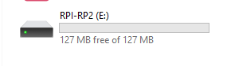
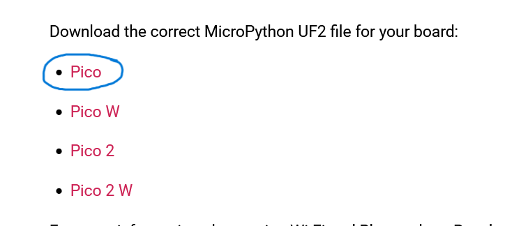
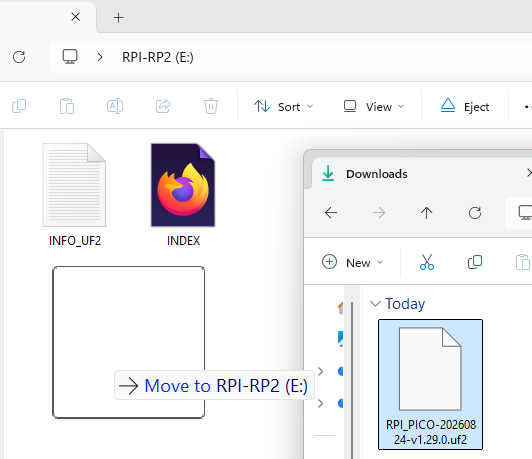
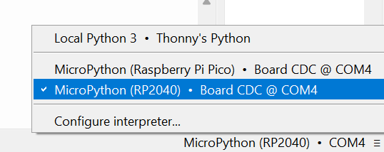
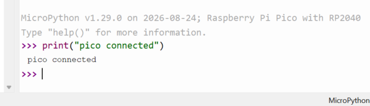

# Raspberry Pi Pico and Thonny Setup

This guide takes you from an unconfigured computer and Raspberry Pi Pico to running a small MicroPython program on the board. You do not need previous Pico experience.

## 1. What You Need

- A Raspberry Pi Pico supplied for the Makeathon
- A USB **data** cable that fits the Pico
- A Windows, macOS, or Linux computer
- The Thonny integrated development environment (IDE)

An IDE is an application for writing and running code. Some USB cables are designed only for charging. A charge-only cable can power the Pico, but the computer and Thonny cannot communicate with it. If the Pico powers up but never appears in Thonny, try a cable known to transfer data.

Before setup, leave the motors, motor controller, battery pack, and sensors disconnected. Connect only the Pico to the computer.

The [Pico pinout in the electronics guide](../electronics/README.md#raspberry-pi-pico) explains the difference between physical header positions and GPIO numbers. No Makeathon-specific GPIO assignment is made in that reference.

## 2. Installing Thonny

Download Thonny only from the [official Thonny website](https://thonny.org/). The site presents the current downloads for each operating system, so installer names and screen wording may differ from this guide.

### Windows

1. On the Thonny website, choose the Windows installer that matches your computer. Most participants will need the standard installer for an Intel or AMD computer.
2. Open the downloaded installer.
3. Follow the setup wizard. The normal/default options are suitable unless you have a specific reason to change them.
4. When installation finishes, open Thonny from the Start menu or its desktop shortcut.

If Windows displays a security prompt, check that the file came from `thonny.org` before continuing.

### macOS

1. On the Thonny website, choose the macOS installer for your Mac. The site provides the appropriate choices for Apple silicon and Intel Macs.
2. Open the downloaded package and follow the installer.
3. Keep the normal/default options unless you have a reason to change them.
4. Open Thonny from the Applications folder.

If macOS asks for confirmation because Thonny was downloaded from the internet, verify that it came from `thonny.org` and approve it through the normal macOS security prompt.

### Linux

1. Visit the Thonny website and read its current Linux installation section.
2. Use the official Linux installer shown there, following the command and prompts provided by the site. A distribution package may also exist, but it can be older than the official release.
3. Keep the normal/default choices unless your system requires something different.
4. Start Thonny from the applications menu or with the command provided by your installation method.

On a managed university computer, you may need help from a supervisor or administrator to install software.

## 3. Connecting the Raspberry Pi Pico

For a normal connection:

1. Open Thonny.
2. Connect the USB data cable to the Pico.
3. Connect the other end to the computer.
4. Wait a few seconds for the operating system to detect it.

If MicroPython is already installed, the Pico may appear as a serial device and can be selected in Thonny. It will not normally appear as a storage drive.

### BOOTSEL mode

**BOOTSEL** is a special mode used mainly to install or recover firmware. You do not normally need it every time you upload a Python file.

1. Disconnect the Pico from USB.
2. Press and hold the **BOOTSEL** button on the Pico.
3. While continuing to hold BOOTSEL, connect the Pico to the computer using USB.
4. Release BOOTSEL after the board is connected.
5. The Pico should appear as a USB storage device, typically named `RPI-RP2`.

If no drive appears, disconnect the Pico and repeat the steps with a known data-capable cable.

> **Board model for this Makeathon:** The supplied board is the standard, original **Raspberry Pi Pico**. When choosing an interpreter or UF2 firmware, select **Raspberry Pi Pico**—not Pico W, Pico 2, or Pico 2 W.

## 4. Installing MicroPython on the Pico

**MicroPython** is the firmware that allows the Raspberry Pi Pico to run Python programs. For the Makeathon, install it using the Pico's BOOTSEL / `RPI-RP2` firmware mode.

1. Disconnect the Pico from USB if it is currently connected.
2. Press and hold the Pico's **BOOTSEL** button.
3. While holding BOOTSEL, connect the Pico to the computer with a USB data cable.
4. Release BOOTSEL after the board is connected.
5. Confirm that the Pico appears as a removable drive named `RPI-RP2`.



*The `RPI-RP2` drive is the Pico's firmware-installation bootloader. It is not the normal place where Python programs are saved.*

6. Open the [official Raspberry Pi MicroPython guide](https://www.raspberrypi.com/documentation/microcontrollers/micropython.html) and download the MicroPython `.uf2` file for the original **Raspberry Pi Pico**.
7. Check that the downloaded file ends in `.uf2` and is for the original Pico. Do not choose Pico W, Pico 2, Pico 2 W, or a preview/development build.



8. Copy or drag the `.uf2` file onto `RPI-RP2`, as you would copy a file to a USB drive.



*Copy the `.uf2` firmware for the original Raspberry Pi Pico onto `RPI-RP2`. The filename shown is an example; stable firmware filenames change as new releases are published.*

9. Wait for the copy to finish. The `RPI-RP2` drive should disappear and the Pico should reboot automatically into MicroPython. This is expected and normally means the firmware is installed.
10. Open Thonny after the Pico has rebooted.
11. Select the MicroPython interpreter for the Raspberry Pi Pico/RP2040 and the serial/COM port belonging to the connected Pico, as described in the next section.

### `.uf2` is firmware; `.py` is your program

- A `.uf2` file contains MicroPython firmware. Copy it to `RPI-RP2` while the Pico is in BOOTSEL mode.
- Ordinary `.py` programs do **not** go onto `RPI-RP2`.
- Save `.py` programs to the Pico's MicroPython filesystem through Thonny after the firmware is installed.
- `main.py` is an ordinary Python file with a special filename that MicroPython runs automatically at startup.

## 5. Selecting the Pico Interpreter in Thonny

Thonny can run ordinary Python on your computer or MicroPython on the Pico. Select the correct interpreter so that your program runs on the board.

1. Open Thonny and connect the Pico normally, without holding BOOTSEL.
2. Find the interpreter selector, commonly near the bottom-right of the Thonny window. If it is not visible, look in the **Run** menu or the interpreter section of Thonny's settings/options.
3. Choose the MicroPython interpreter for **Raspberry Pi Pico** or **RP2040**. Exact wording varies between Thonny versions.
4. Select the Pico's USB/serial or COM port. An automatic port option may work; otherwise select the device that appears when the Pico is connected.
5. Confirm or apply the settings.
6. Show Thonny's **Shell** panel if it is hidden. A MicroPython prompt containing `>>>` should become available.



*Selecting the Pico interpreter in Thonny. Choose the MicroPython Raspberry Pi Pico/RP2040 interpreter and the COM port belonging to the connected Pico. Exact wording may vary between Thonny versions.*

If **Local Python**, **Python 3**, **Thonny's Python**, or wording such as “the same interpreter which runs Thonny” is selected, hardware code may run on the computer instead of the Pico.

## 6. Testing the Connection

The **REPL** (read-evaluate-print loop) is the interactive `>>>` prompt in Thonny's Shell. Click after the prompt, type this line, and press Enter:

```python
print("Pico connected")
```

You should see:

```text
Pico connected
```



This confirms that Thonny can send a command to MicroPython and receive its response. It does not test sensors or motors.

If no prompt appears, press Thonny's Stop/Interrupt control, wait a moment, and check the interpreter and port again. Reconnect using a known data cable if necessary.

## 7. Saving and Uploading Code to the Pico

There are three related but different actions:

- **Run from the editor:** Thonny sends the current program to the selected interpreter for a test run. This does not necessarily store the file permanently on the Pico.
- **Save on the computer:** the file remains on the computer but is not stored on the Pico.
- **Save on the Pico:** the file is written to the Pico's own MicroPython filesystem and remains there after it is disconnected.

To try the complete workflow:

1. Open a new file in Thonny.
2. Write a simple program such as `print("Hello from the Pico")`.
3. Confirm that the Pico's MicroPython interpreter is selected, then press Run.
4. Check the result in the Shell.
5. Save the file.
6. When Thonny asks where to save it, choose **Raspberry Pi Pico** (or the equivalent device option).
7. Give it an appropriate name ending in `.py`, such as `hello.py`.

Keep a separate copy on the computer when the file is important. For more detail, continue to [Uploading Code to the Pico](uploading_code.md).

Once MicroPython is working, use the [uploading guide](uploading_code.md) to understand the difference between USB-connected testing through Thonny and saving a program for standalone, untethered operation.

## 8. `main.py`

A MicroPython file named `main.py` on the Pico normally runs automatically when the board boots. This is useful for a final robot program that should start without Thonny.

While experimenting, save programs under descriptive names first. Only save or rename the intended startup program as `main.py` once you understand and have tested it. A faulty `main.py` can start repeatedly and make the board seem difficult to reconnect; Stop/Interrupt can often regain the REPL.

## 9. Running Code

Use Thonny's green Run button or Run command to execute the file with the selected Pico interpreter. Output and error messages appear in the Shell.

Use Stop/Interrupt to end a program. If the interpreter becomes unresponsive, use Thonny's soft-restart or restart-interpreter command; its exact label and location can vary by version. Read the first error shown in the Shell because it normally identifies the line where MicroPython first encountered a problem.

An endless loop may not finish by itself:

```python
while True:
    ...
```

This is a syntax illustration, not robot code. Stop it manually with Stop/Interrupt before editing hardware or disconnecting the Pico.

## 10. Updating Code

Normal development is a repeated edit-and-test process:

```text
Edit code
    ↓
Run on Pico
    ↓
Observe behaviour
    ↓
Stop
    ↓
Modify code
    ↓
Run again
```

You do **not** need to reinstall MicroPython whenever you change a program. Firmware installation is normally a one-time setup or recovery task.

## 11. Disconnecting Safely

- Stop the running program where practical.
- Do not unplug the Pico during firmware installation or while a file is being written.
- Switch off and disconnect robot power before changing motor, motor-driver, or battery wiring.
- After file activity has finished, disconnect the USB cable by its plug rather than pulling the cable.

Next: [understand MicroPython](micropython_setup.md) · [upload code](uploading_code.md) · [troubleshooting](../troubleshooting/README.md)
