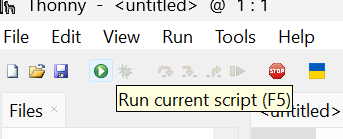
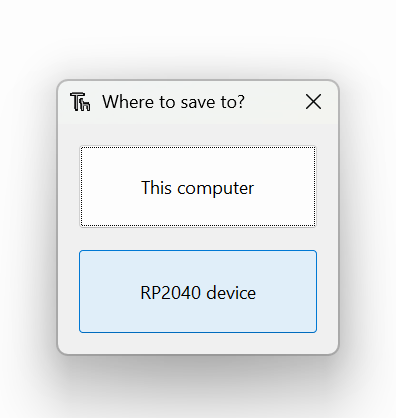
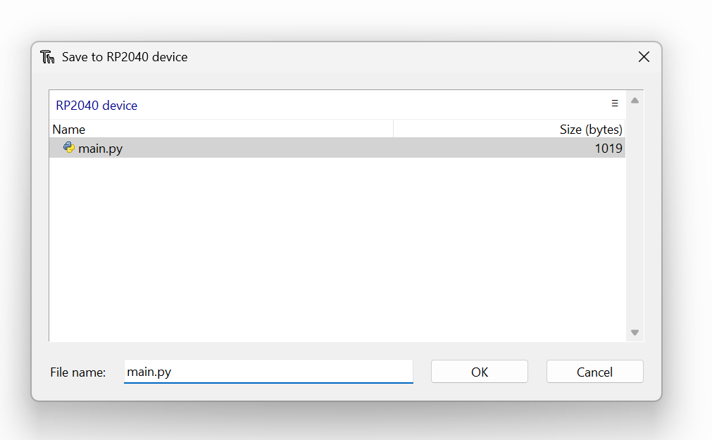

# Getting Your Code onto the Pico

Complete the [Pico and Thonny setup guide](pico_setup.md) first. These steps assume Thonny can already reach the Pico's MicroPython REPL.

During the Makeathon, USB is for programming and debugging. The finished robot must run **untethered**, without the computer or USB cable, so its final program must be saved on the Pico and the robot powered from its onboard supply.

| Action | USB/PC needed while running? | Stored on Pico? | Auto-runs at boot? |
|---|---|---|---|
| Run from Thonny | Yes, for the normal debugging workflow | Not necessarily | No |
| Save a normal `.py` file to the Pico | No, after saving | Yes | No |
| Save as `main.py` on the Pico | No, after saving | Yes | Yes |

When the Pico MicroPython interpreter is selected, the **Pico executes the code**. Method 1 still uses the PC, USB connection, and Thonny to control that test session; it does not mean the code runs as desktop Python on the PC.

## Method 1 — Run Directly from Thonny

This is the fastest method while experimenting.

> **USB-connected testing only**
>
> Running a script directly from Thonny is intended for testing and debugging while the Pico is connected to the computer by USB. The program is sent to the Pico's MicroPython interpreter and runs on the Pico, but an unsaved editor file is not necessarily stored permanently on it.
>
> If you disconnect USB before saving the program to the Pico, that unsaved editor program will not automatically be available for untethered operation.

Use this method for experimentation, viewing `print()` output, checking errors, and quickly testing code changes.

1. Connect the Pico with a USB data cable.
2. In Thonny, select the MicroPython interpreter for the Raspberry Pi Pico/RP2040 and choose the Pico's USB/serial or COM port. Exact wording varies between versions.

*Selecting the Pico interpreter in Thonny. Choose the MicroPython Raspberry Pi Pico/RP2040 interpreter and the COM port belonging to the connected Pico. Exact wording may vary between Thonny versions.*

3. Open an existing `.py` file or create a new one.
4. Press the green Run button or use Thonny's Run command.

*The Run current script button starts a test session through Thonny. It does not by itself guarantee that the editor file has been saved on the Pico.*

5. Observe output and errors in the Shell.
6. Use Stop/Interrupt before making hardware changes.

Running an unsaved editor file can send it to the Pico interpreter temporarily. It does not guarantee that the program has been stored on the Pico or that it will start after the next power-up.

## Method 2 — Save the File onto the Pico

Use this method for persistent code that must remain available after the computer is disconnected. A normal `.py` file stays on the Pico but does not start automatically; the tested final program must be named `main.py` for automatic untethered startup.

1. Connect the Pico and select its MicroPython interpreter.
2. Open or create the program in Thonny.
3. Choose **Save As** from the File menu, or use the equivalent save command in your Thonny version.
4. When asked for a location, choose **RP2040 device**, **Raspberry Pi Pico**, or the equivalent device option—not **This computer**.

*Choose where to save. `This computer` saves only on the PC. Select the RP2040/Pico device when the program needs to remain on the Pico after the computer is disconnected.*

5. Enter a descriptive filename ending in `.py`.
6. Save the file, then run it and check the Shell.

Files saved to the device this way are stored on the board's MicroPython filesystem. Pressing Run can send code for a temporary test, but it is not the same as permanently saving the file. Keep a separate copy on the computer as a backup.

## Running Automatically at Startup

A file named `main.py` on the Pico normally runs when MicroPython boots. Use that name only for a program you have tested and intentionally want to start automatically.

*Saving `main.py` on the Pico. Ordinary test programs can use any sensible `.py` filename; use `main.py` only when the tested program should start automatically without the computer.*

> **Only save or rename the finished program as `main.py` after testing.** A broken `main.py`, especially one containing an infinite loop, starts automatically on every boot. Use Stop/Interrupt immediately after connecting to regain access, then follow the [recovery guidance below](#common-thonny-connection-problems) or the main [troubleshooting page](../troubleshooting/README.md).

## What happens if I unplug the USB cable?

If you only pressed Run in Thonny and never saved the program onto the Pico, do not expect that editor file to start automatically after USB is disconnected. Reconnecting or powering the Pico does not restore an unsaved Thonny editor program as a stored Pico file.

For final untethered operation:

1. Test the program on the Pico through Thonny.
2. Save the program to the **RP2040/Pico device**, not only to the computer.
3. Once the final program works, save it as `main.py` on the Pico.
4. Stop the test program.
5. Disconnect USB.
6. Power the Pico from the robot's documented onboard power system.
7. When MicroPython boots, it automatically runs `main.py`.

## Is the Code on the Pico or Only on the Computer?

Look at where Thonny says the file is stored:

- A normal computer path means the file is on the computer.
- A device/Pico location means the file is on the Pico.
- If a program runs but no saved Pico file is visible, Thonny may only have sent the editor contents for that run.

A simple check is to stop the program, close its editor tab, and use Thonny's device file browser or Open command to inspect files on the Raspberry Pi Pico. Do not assume that pressing Run also saved the file.

## Common Thonny Connection Problems

| Problem | Simple recovery step |
|---|---|
| Pico does not appear | Reconnect it, try another USB port, and use a known data-capable cable. |
| Wrong interpreter selected | Select MicroPython for the exact Raspberry Pi Pico model, not desktop Python 3. |
| Wrong serial or COM port | Choose the port that appears when the Pico is connected; disconnect/reconnect to identify it. |
| Charge-only USB cable | Replace it with a cable known to transfer files or data. |
| MicroPython is not installed | Follow the BOOTSEL + `RPI-RP2` + `.uf2` procedure in the [Pico setup guide](pico_setup.md). |
| Pico keeps running old code | Press Stop/Interrupt, inspect files stored on the Pico, and check whether an old `main.py` starts automatically. |
| Shell says the device is busy | Stop the running program, wait briefly, and restart the interpreter if needed. |
| Connection was interrupted | Stop, reconnect the USB cable, reselect the Pico interpreter/port, and run again. |
| `main.py` immediately enters an infinite loop | Press Stop/Interrupt soon after reconnecting; then rename, edit, or remove the faulty startup file. |
| Another program owns the serial port | Close other editors, terminal programs, and serial monitors that may be connected to the Pico, then reconnect in Thonny. |

For firmware recovery, disconnect the robot's other power sources and repeat the BOOTSEL + `RPI-RP2` + `.uf2` procedure in the [Pico setup guide](pico_setup.md). Use the current stable build for the original Raspberry Pi Pico, not firmware for a different Pico model. Firmware recovery is not required for ordinary code edits.

Do not place `.py` programs on the `RPI-RP2` drive. That BOOTSEL drive accepts `.uf2` firmware; programs belong on the MicroPython device filesystem through Thonny.

See [Pico and Thonny setup](pico_setup.md), [understanding MicroPython](micropython_setup.md), and [troubleshooting](../troubleshooting/README.md).
