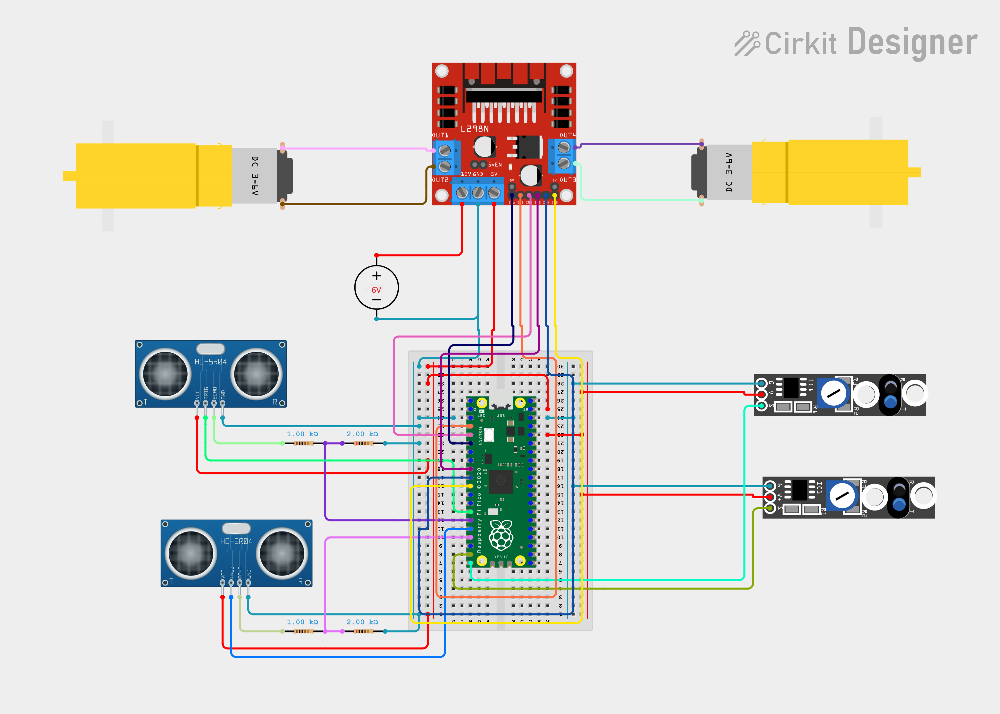

# Full-System Wiring

This page is the authoritative textual wiring reference for the Makeathon robot. MicroPython uses the GPIO numbers (`GP2`, `GP3`, and so on), not the physical header-pin numbers.

If you need to understand why a connection, voltage, divider, or motor-driver pin is required, return to the core [Electronics Guide](../electronics/README.md) before continuing.

## Final Makeathon Wiring Diagram

*Complete electrical wiring for the Pico, L298N, both motors, both IR sensors, both ultrasonic sensors, their separate Echo voltage dividers, the nominal 6 V battery supply, the 5 V supply rail, the 3.3 V IR-sensor supply, and common ground. Open the image at full size when tracing individual wires.*

Use the connection tables below as the exact pin reference. Wire colours in the image are illustrative, not an electrical standard. Check the continuity of the actual breadboard power rails, and disconnect battery and USB power before changing any wiring.

## Final signal connections

| Function | Pico GPIO | Physical pin | Connected device | Device pin | Purpose |
|---|---:|---:|---|---|---|
| Left motor direction 1 | GP2 | 4 | L298N | IN1 | Left motor direction control |
| Left motor direction 2 | GP3 | 5 | L298N | IN2 | Left motor direction control |
| Left motor PWM/enable | GP4 | 6 | L298N | ENA | Left motor speed/enable |
| Right motor direction 1 | GP6 | 9 | L298N | IN3 | Right motor direction control |
| Right motor direction 2 | GP7 | 10 | L298N | IN4 | Right motor direction control |
| Right motor PWM/enable | GP8 | 11 | L298N | ENB | Right motor speed/enable |
| Ultrasonic 1 trigger | GP10 | 14 | HC-SR04 #1 | TRIG | Starts a distance measurement |
| Ultrasonic 1 echo | GP11 | 15 | HC-SR04 #1 | ECHO through its own divider | Receives the reduced-voltage echo pulse |
| Ultrasonic 2 trigger | GP12 | 16 | HC-SR04 #2 | TRIG | Starts a distance measurement |
| Ultrasonic 2 echo | GP13 | 17 | HC-SR04 #2 | ECHO through its own divider | Receives the reduced-voltage echo pulse |
| Left line reading | GP14 | 19 | Left IR sensor | OUT | Reads the left surface sensor |
| Right line reading | GP15 | 20 | Right IR sensor | OUT | Reads the right surface sensor |
| Common reference | Pico GND | Any convenient GND pin | Common GND rail | GND | Shared voltage reference |

GPIO numbers—not physical pin numbers—belong inside `Pin(...)` in MicroPython.

## Final power connections

| From | To | Purpose |
|---|---|---|
| 4×AA battery holder positive, nominal 6 V | L298N motor-supply positive | Motor-system power |
| 4×AA battery holder negative | L298N GND/common GND | Power return |
| L298N `5V` terminal | Pico `VSYS` | Untethered Pico power |
| L298N `5V` terminal | HC-SR04 #1 VCC | Ultrasonic sensor power |
| L298N `5V` terminal | HC-SR04 #2 VCC | Ultrasonic sensor power |
| Pico `3V3(OUT)` | Left IR sensor VCC | Regulated 3.3 V sensor power |
| Pico `3V3(OUT)` | Right IR sensor VCC | Regulated 3.3 V sensor power |
| Common GND | Pico, L298N, both IR sensors, both HC-SR04 sensors, and battery negative | Shared return and signal reference |

The Pico is supplied with 5 V through `VSYS`, but its GPIO remains 3.3 V logic. `3V3(OUT)` is a regulated output, not a battery input. `VBUS` is the USB-derived rail and is not used as the robot's untethered supply.

## Echo dividers

Each HC-SR04 has its own divider. For each sensor, connect a 1 kΩ resistor from ECHO to the Pico-input node and a 2 kΩ resistor from that node to common GND. HC-SR04 #1's node connects to GP11; HC-SR04 #2's node connects to GP13. Do not share one divider between the sensors.

## Motor and enable mapping

Motor A is the left motor and connects to L298N OUT1/OUT2. Motor B is the right motor and connects to OUT3/OUT4. GP4 controls ENA and GP8 controls ENB using PWM, so remove the ENA and ENB jumpers if they permanently hold those inputs HIGH.

The ENA jumper, ENB jumper, and 5V-EN/regulator jumper have different functions. The regulator jumper must remain configured for the final L298N 5 V power architecture; do not confuse it with the two motor-enable jumpers.

An IN1/IN2 or IN3/IN4 state cannot be labelled universally as physical “forward.” Actual wheel direction depends on motor mounting and the order of its two output wires. Test with the wheels raised.

## Before powering on

Complete the exact [pre-power check](../guides/pre_power_check.md). Remove all power before changing wiring.

Detailed pages: [Pico to IR sensors](pico_to_ir_sensors.md) · [Pico to ultrasonic sensors](pico_to_ultrasonic.md) · [Pico to L298N](pico_to_l298n.md) · [motors to L298N](motors_to_l298n.md) · [battery pack](battery_pack.md) · [electronics guide](../electronics/README.md)
